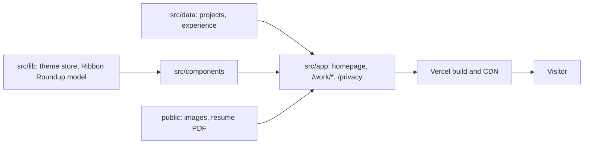

# JessBuilds Portfolio Architecture

<!-- The current shape of the site across all features. Per-feature technical detail lives in specs/NNN-*/plan.md. The "why" behind choices lives in docs/adr/. Update this when components or their connections change. -->

**Last updated:** 2026-10-20

## Overview

A Next.js App Router site with no backend. Pages are rendered from typed content in `src/data/` through shared components, built by Vercel and served as static pages. The only client-side state is the visitor's theme choice (and the Ribbon Roundup game's best score) in `localStorage`.

## Components

| Component      | Responsibility                                                                                                                                                       | Location                                                                                                 |
| -------------- | -------------------------------------------------------------------------------------------------------------------------------------------------------------------- | -------------------------------------------------------------------------------------------------------- |
| Homepage       | Hero (with impact links), featured project hand, experience, how I engineer, about, contact                                                                          | `src/app/page.tsx`                                                                                       |
| Homepage hero  | Copy, actions, four impact links, motif divider and scroll cue (server `Hero`); decorative fairy canvas (client `HeroFairy`); Pokémon-only "Take a play break" badge | `src/components/Hero.tsx`, `src/components/HeroFairy.tsx`, `src/lib/hero-fairy.ts`, `src/data/impact.ts` |
| Case studies   | One route per featured project                                                                                                                                       | `src/app/work/<slug>/page.tsx`, `src/components/case-study/`                                             |
| Content        | Project and experience data the pages render                                                                                                                         | `src/data/projects.ts`, `src/data/experience.ts`                                                         |
| Themes         | Light, Dark and Pokémon appearance, saved choice, system preference                                                                                                  | `src/lib/theme.ts`, `src/lib/theme-store.ts`, `src/components/ThemeToggle.tsx`, `src/app/globals.css`    |
| Ribbon Roundup | Optional game in Pokémon mode                                                                                                                                        | `src/lib/ribbon-roundup.ts`, `src/components/game/`                                                      |
| Social preview | Open Graph image                                                                                                                                                     | `src/app/opengraph-image.tsx`                                                                            |
| Privacy page   | Privacy policy for the job-hunt-pipeline tool                                                                                                                        | `src/app/privacy/page.tsx`                                                                               |
| Redirects      | Old URLs to new ones (`/work/loot-membership` to `/work/rolesync`)                                                                                                   | `next.config.ts`                                                                                         |

## Homepage hero

`Hero` is a server component: copy, actions, the four impact links (from `src/data/impact.ts`, each jumping to a section or case study), a motif divider and a static scroll cue. There is no separate impact section. `HeroFairy` is a client canvas that draws the decorative fairy; its movement comes from the pure state machine in `src/lib/hero-fairy.ts`, which keeps the logic testable without a browser. The "Take a play break" badge is `RibbonRoundupLauncher`'s badge variant, shown only in Pokémon mode through CSS on `[data-theme="pokemon"]`, so the page renders the same HTML in every theme.

## Data

No database or CMS. Copy and project facts are authored in `src/data/` and the page files; screenshots live in `public/work/<slug>/`.

## External Integrations

None at runtime. Links go out to GitHub, LinkedIn and live project sites; contact is a mailto link.

## Cross-Cutting Concerns

- **Auth:** none.
- **Config and secrets:** none needed; `.env.example` lists public variable names if any are added.
- **Accessibility:** axe checks and keyboard, focus and reduced-motion tests in `tests/e2e/`.
- **Privacy:** no cookies, forms or tracking. `/privacy` is the privacy policy for the job-hunt-pipeline tool, not for the site.

## Deployment

Vercel's Git integration: a preview deploy per PR, production from `main` at https://www.jessbuilds.dev. GitHub Actions (`.github/workflows/ci.yml`) runs `scripts/check.sh` on every PR and push to `main`.

## Key Decisions

See `docs/adr/README.md` for the full list.
